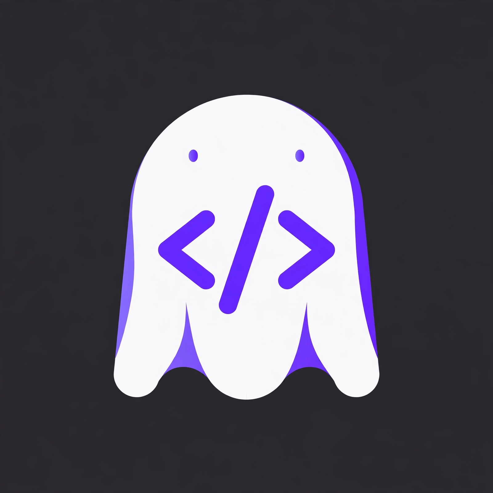

<p align="center">
  
</p>

# Ryan Cotten

**Founder, Ghost Developer Studio — Oakdale, Tennessee**

## About

Ghost Developer Studio is an independent software studio in Oakdale, Tennessee. We build developer tools, AI-agent safety software, apps, and websites for local businesses — and we sell by showing working software, not slide decks.


*The studio's roadmap board — every product, its status, and its next gate — lives in [ghost-roadmaps](https://github.com/littlestjames82-sys/ghost-roadmaps).*

## Featured work

### The governed-agent core

| Project | What it is |
| --- | --- |
| [Agent Seatbelt](https://github.com/littlestjames82-sys/agent-seatbelt) | Deterministic guardrails for AI coding agents (Claude Code plugin). Gates what your agent does before it does it — 206/206 on the open Seatbelt Bench, zero false positives. On [PyPI](https://pypi.org/project/ghost-seatbelt/) as `ghost-seatbelt` — `pip install ghost-seatbelt`; v0.2.0. |
| [GhostGuard](https://github.com/littlestjames82-sys/ghostguard) | Record-first governance for AI agents: a gateway that classifies, decides, and records every agent act before it executes — fail-closed policy, approvals, and audit. The GhostGuard family adds an MCP adapter, budgets & kill-switch, a secrets broker, policy replay, pre-written policy packs, and more — start at the core repo. |
| [Ghost Hands](https://github.com/littlestjames82-sys/ghost-hands) | Governed, recorded, replayable agent hands — our own zero-dependency CDP stack. On [PyPI](https://pypi.org/project/ghost-hands/) as `ghost-hands` 0.3.0 (`pip install ghost-hands`) — 170 tests, bench 82/82 + live 2/2. [Site](https://littlestjames82-sys.github.io/ghost-hands/) |
| [GhostBus](https://github.com/littlestjames82-sys/ghostbus) | Agent-to-agent message bus + shared workspace, exposed as an MCP server. Zero dependencies. |
| [Ghost Bridge](https://github.com/littlestjames82-sys/ghost-bridge) | An MCP bridge + self-hostable relay that lets AI agents in other tools hand tasks to your own agent, with scoped keys, approvals, and an audit trail. |

Install Agent Seatbelt in Claude Code:

```
/plugin marketplace add littlestjames82-sys/agent-seatbelt
```

### Creator & business products

| Project | What it is |
| --- | --- |
| GhostCut | The studio's video editor — a rebranded, client-side editor the studio uses for its product films and social cuts, with narration and templates. Studio work; no public repo. |
| [Storefront](https://github.com/littlestjames82-sys/storefront) | One-page websites + lead capture for trades businesses. [Live demo](https://storefront-ghost-dev.netlify.app) |
| [GhostChat](https://github.com/littlestjames82-sys/ghostchat) | Live-chat & omnichannel inbox for small businesses — the studio's rebrand of Chatwoot (MIT), with upstream attribution intact. |
| [Decksmith](https://github.com/littlestjames82-sys/decksmith) | Cyberdeck design & fabrication studio (deploy mirror — the app lives on the repo's deploy branches). |

## Currently

Building in public — Agent Seatbelt v0.2.0 is live on PyPI, the GhostGuard family is public on GitHub, GhostBus and Ghost Bridge connect agents across tools, and the [roadmap board](https://github.com/littlestjames82-sys/ghost-roadmaps) shows where everything stands.

## Hacktoberfest 2026

Two contributions to [UseAgent](https://github.com/useagenthq/useagent), an open-source AI agent platform. Both accepted and in `main`, both passing full CI (19/19 checks):

- [Show a routine's past runs from the Bots page](https://github.com/useagenthq/useagent/pull/121) — a History drawer for routines, labeled `hacktoberfest-accepted` and merged into main as [40763fab6](https://github.com/useagenthq/useagent/commit/40763fab6). The maintainer: "clean change that reuses what was already there."
- [Render Mermaid diagrams in thread messages](https://github.com/useagenthq/useagent/pull/135) — merged. The maintainer: "nice work, and the lazy load keeps the page light."

## Links

- Website: [Ghost Developer Studio](https://muse.ai/s/ghost-developer-studio-xsxh6xdxwxtxlbxs7e)
- Facebook: [Ghost Developer Studio](https://www.facebook.com/profile.php?id=61594546750800)
- GitHub: [@littlestjames82-sys](https://github.com/littlestjames82-sys)

---

*Most of my work ships from the studio, not the org chart — if it runs, there's a repo or a demo.*
